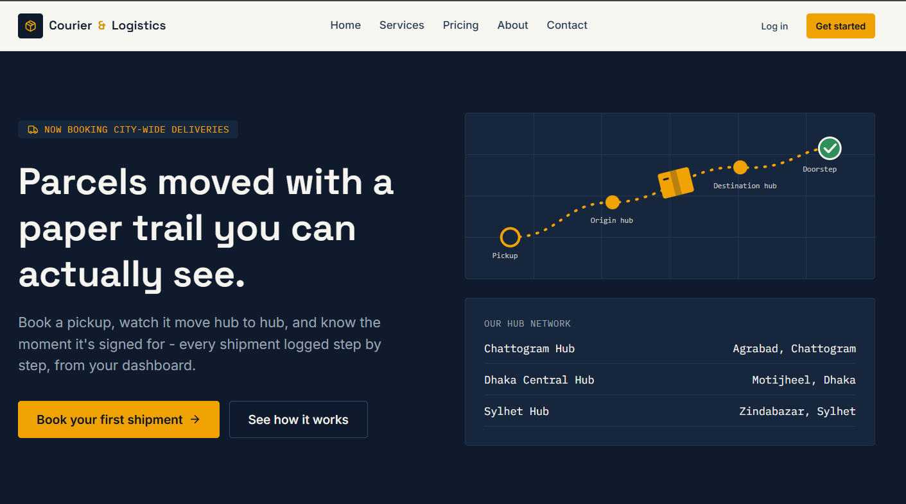

# 🚚 Courier & Logistics Platform — Frontend

A role-based courier management web app built with Next.js (App Router). Customers book and pay for shipments, admins assign couriers, and couriers update delivery status step by step, all against a real backend API with no mock data.

[🌐 Live Site](https://courier-logistics-frontend-delta.vercel.app) • [⚙️ Live API](https://courier-logistics-backend.vercel.app) • [📚 API Docs](https://documenter.getpostman.com/view/54821626/2sBYAxP9DV)




## 🛠️ Tech Stack

| Area | Technology |
|---|---|
| Framework | Next.js 16 (App Router), React 19, TypeScript (strict) |
| Styling | Tailwind CSS v4, Radix UI primitives, class-variance-authority |
| Data fetching | TanStack Query |
| State | Zustand |
| Forms & validation | React Hook Form + Zod |
| Charts | Recharts |
| Notifications | Sonner |
| Payment | SSLCommerz (sandbox, via backend) |
| Deployment | Vercel |

## ✨ Core Features

- 🔐 Role-based access for **Customer**, **Courier** and **Admin**, with middleware route protection
- 🔑 Secure auth using JWT in httpOnly cookies (BFF pattern with automatic token refresh)
- ⚡ One-click **Demo Login** for all three roles
- 📦 3-step shipment booking wizard with SSLCommerz payment
- 🕒 Live shipment status timeline, updated step by step by the courier
- 🛠️ Admin panel: assign couriers, manage users, hubs (full CRUD) and reports
- 📊 Charts on the admin overview and courier earnings pages
- 🔎 URL-synced search, filter, sort and pagination on every list page
- ♿ Loading skeletons, error boundaries, toasts and SEO metadata on all pages

## 👥 Demo Accounts

| Role | Email | Password |
|---|---|---|
| Admin | admin@courier.com | Admin123! |
| Customer | customer@test.com | password123 |
| Courier | courier@test.com | password123 |

These are demo-only accounts created for evaluation.

## 📦 Dependencies

**Production:** next, react, react-dom, @tanstack/react-query, zustand, react-hook-form, @hookform/resolvers, zod, recharts, sonner, lucide-react, date-fns, js-cookie, clsx, tailwind-merge, class-variance-authority, @radix-ui/react-dialog, @radix-ui/react-label, @radix-ui/react-select, @radix-ui/react-slot, @radix-ui/react-tabs, server-only

**Development:** typescript, tailwindcss, @tailwindcss/postcss, eslint, eslint-config-next, prettier, prettier-plugin-tailwindcss, @types/node, @types/react, @types/react-dom, @types/js-cookie

## 🚀 Run Locally

**Prerequisites:** Node.js 18+ and npm

1. Clone the repository
   ```bash
   git clone https://github.com/aflazur/courier-logistics-frontend.git
   ```
2. Go to the project folder
   ```bash
   cd courier-logistics-frontend
   ```
3. Install dependencies
   ```bash
   npm install
   ```
4. Create your environment file
   ```bash
   cp .env.example .env.local
   ```
5. Set the backend URL in `.env.local`
   ```env
   BACKEND_API_URL=https://courier-logistics-backend.vercel.app/api/v1
   ```
6. Start the dev server and open http://localhost:3000
   ```bash
   npm run dev
   ```

Other scripts: `npm run build` (production build), `npm start` (serve the build), `npm run lint`.

## 🔗 Links

| | |
|---|---|
| Live frontend | https://courier-logistics-frontend-delta.vercel.app |
| Live backend | https://courier-logistics-backend.vercel.app |
| Backend repo | https://github.com/aflazur/courier-logistics-backend |
| API docs | https://documenter.getpostman.com/view/54821626/2sBYAxP9DV |

## 👨‍💻 Author

**Aflazur Rahaman** — Full Stack Web Developer
GitHub: [@aflazur](https://github.com/aflazur)